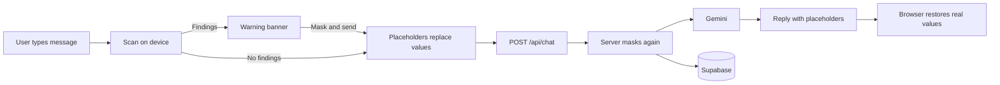
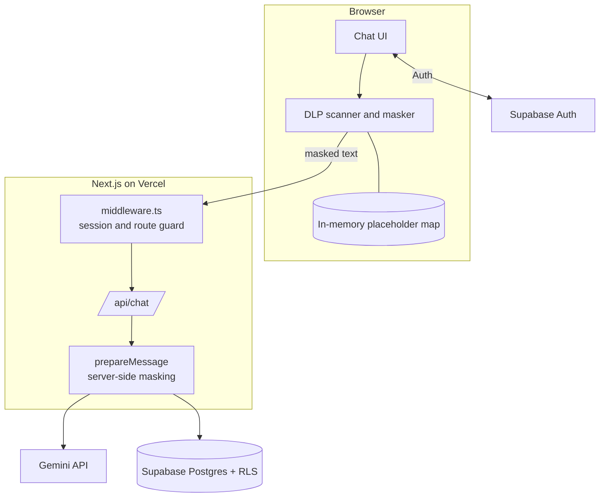

# 🛡️ PromptOS

### A privacy-first AI chat app with a built-in Data Loss Prevention shield

Sensitive data is detected and masked on your device **before** it reaches the AI model or the database, then restored in your browser when the reply arrives.


</div>

---

## 📑 Table of Contents

- [✨ Overview](#-overview)
- [🚀 Features](#-features)
- [🧠 How the DLP Shield Works](#-how-the-dlp-shield-works)
- [🏗️ Architecture](#️-architecture)
- [🧰 Tech Stack](#-tech-stack)
- [🔐 Security Model](#-security-model)
- [🔌 Chat API](#-chat-api)
- [⚙️ Getting Started](#️-getting-started)
- [🗄️ Database](#️-database)
- [🧪 Testing](#-testing)
- [☁️ Deployment](#️-deployment)
- [📁 Project Structure](#-project-structure)
- [⚠️ Known Limitations](#️-known-limitations)
- [🗺️ Roadmap](#️-roadmap)
- [📄 License](#-license)

---

## ✨ Overview

People paste personal details into AI chats without thinking: ID numbers, phone numbers, card numbers, API keys. Once sent, that data sits on third-party servers.

**PromptOS** puts a protection layer between the user and the model. Every message is scanned on the device. Sensitive values are swapped for typed placeholders such as `[AADHAAR_1]`, so the model and the database only ever see safe text. When the answer comes back, the real values are put back **locally in the browser**.

The project started as a platform where creators built AI mini-apps. It has since been simplified into a focused chat product, and the creator features are disabled (see [Known Limitations](#️-known-limitations)).

---

## 🚀 Features

| | Feature | Details |
|---|---|---|
| 🛡️ | **DLP Shield** | Detects Aadhaar, PAN, Indian mobile numbers, payment cards and API keys while you type |
| ⚠️ | **Warning banner** | Shows what was found, for example "Sensitive data found: Aadhaar x1, Phone x1", with **Mask and send** and **Edit** actions |
| 🔁 | **Local restoration** | Placeholders in the reply are swapped back to real values in the browser only |
| 🧱 | **Server-side safety net** | `/api/chat` masks every message again, so requests that bypass the interface are still protected |
| 💬 | **Chat history** | Conversations and messages stored in Supabase, with a sidebar of recent chats |
| 🔑 | **Authentication** | Supabase Auth with cookie sessions and row-level security |
| 🌐 | **Indic digit support** | Tamil and Hindi numerals are normalized before checksum validation |

---

## 🧠 How the DLP Shield Works



1. **Detect.** The scanner in `src/lib/dlp.js` runs on the device:
   - **Aadhaar** numbers, validated with the Verhoeff checksum
   - **PAN** numbers
   - **Indian mobile** numbers
   - **Payment cards**, validated with the Luhn checksum
   - **API keys**, matched by known prefixes
   - Nearby words are used to judge confidence, which reduces false alarms on ordinary numbers.
2. **Mask.** Each value becomes a typed placeholder. Numbering is scoped to the conversation, so a later message gets `[AADHAAR_2]` instead of reusing `[AADHAAR_1]`. The shared logic is in `lib/chat/prepare.ts`, so the browser and the server number placeholders identically.
3. **Send.** Only masked text goes to `/api/chat`.
4. **Re-check.** The server masks the incoming message, the conversation history and the model's reply before they reach Gemini or Supabase.
5. **Restore.** The placeholder-to-value map lives in component memory only, separately for each response, so concurrent requests can never restore each other's values.

---

## 🏗️ Architecture



---

## 🧰 Tech Stack

| Area | Choice |
|---|---|
| Framework | Next.js 14 (App Router) with TypeScript |
| Styling | Tailwind CSS |
| Auth and database | Supabase (Auth with SSR cookie sessions, Postgres, RLS) |
| AI model | Google Gemini through `@google/genai` |
| Hosting | Vercel |
| Testing | Node.js scripts using synthetic data |

---

## 🔐 Security Model

| Principle | How it is applied |
|---|---|
| **Local first** | Detection and masking happen on the device before any request is made |
| **Defence in depth** | The browser masks, then the server independently masks again |
| **No raw secrets in storage** | The placeholder map is never written to storage, cookies, the database, logs or any request |
| **Least privilege** | The chat route uses the signed-in user's own Supabase client, so row-level security applies; it never uses an admin client |
| **No content logging** | Message bodies are not logged |
| **Secrets stay server-side** | The Gemini key is only read in server code and never appears in client bundles |
| **Fail closed** | If the rate-limit check fails, the request is refused |
| **Disabled legacy surface** | Old creator routes return 404 at the middleware layer |

> ⚠️ Masking reduces the chance of leaking personal data to a model provider. It does not replace your own judgement about what you paste into a chat.

---

## 🔌 Chat API

`POST /api/chat`

- 🔒 Requires a signed-in user (401 otherwise)
- 📏 Message length of 1 to 4000 characters
- ⏱️ Rate limit of 10 messages per minute per user
- 🆔 `conversationId` must be a valid UUID and is loaded through row-level security
- 📜 The last 20 messages are sent as history, all masked
- 🔄 Brief automatic retries when Gemini reports a temporary overload
- 🗂️ A conversation is created only after the model returns a reply

---

## ⚙️ Getting Started

### Prerequisites

- Node.js 18 or newer
- A Supabase project
- A Google Gemini API key

### Installation

```bash
git clone <your-repo-url>
cd <your-repo-folder>
npm install
cp .env.example .env.local
```

### Environment variables

| Variable | Exposure | Purpose |
|---|---|---|
| `NEXT_PUBLIC_SUPABASE_URL` | Browser | Supabase project URL |
| `NEXT_PUBLIC_SUPABASE_ANON_KEY` | Browser | Supabase public (anon) key |
| `GEMINI_API_KEY` | 🔒 Server only | Google Gemini API key |
| `GEMINI_MODEL` | 🔒 Server only | Gemini model name to use |
| `NEXT_PUBLIC_SITE_URL` | Browser | Public site URL (optional) |
| `TEST_EMAIL`, `TEST_PASSWORD` | Local only | Optional test account for the live login tests |

> 🚫 Never commit `.env.local`. The Supabase service-role key is not needed for chat.

### Run

```bash
npm run dev      # development server on http://localhost:3000
npm run build    # production build
npm run start    # run the production build
```

---

## 🗄️ Database

The database schema and Row Level Security policies are managed in Supabase and are **not included** in this repository. The chat route expects two tables:

| Table | Columns used |
|---|---|
| `conversations` | `id`, `user_id`, `title`, `updated_at` |
| `messages` | `conversation_id`, `user_id`, `role`, `content`, `created_at` |

Enable RLS on both tables and add policies so each signed-in user can read and write only the rows where `user_id` matches their own id.

---

## 🧪 Testing

All tests use synthetic data. The unit and mock suites need no setup:

```bash
node tests/dlp_shield_test.mjs              # checksums, detection, masking
node tests/dlp_extended_test.mjs            # cards, API keys, Tamil and Hindi digits
node tests/multiturn_dlp_test.mjs           # conversation-scoped numbering
node tests/concurrent_restoration_test.mjs  # isolation between concurrent responses
node tests/chat_route_mock_test.mjs         # route handler behavior
node tests/server_side_dlp_bypass_test.mjs  # raw input sent straight to the API
```

`tests/prod_verification_test.mjs` and `tests/curl_verification.mjs` check a running production server (`npm run build`, then `npm run start`) and need `TEST_EMAIL` and `TEST_PASSWORD` in `.env.local`.

---

## ☁️ Deployment

1. 📤 Push the repository to GitHub.
2. 🔗 Import it in Vercel. No `vercel.json` is needed.
3. 🔑 Add the environment variables in the Vercel dashboard, never in the code.
4. 🔁 In Supabase, open **Authentication → URL Configuration**. Set the Site URL to your deployed address and add `https://<your-domain>/**` and `https://<your-domain>/api/auth/callback` to the redirect URLs.
5. 🔄 Redeploy after changing any environment variable.

---

## 📁 Project Structure

```
.
├── app/              Pages and API routes (chat, auth)
├── components/       Chat interface and UI components
├── lib/              Supabase clients, chat message preparation, helpers
├── src/lib/dlp.js    DLP Shield: scanner, masking, restoration
├── middleware.ts     Session handling and route protection
├── tests/            Synthetic-data test suites
├── types/            Shared TypeScript types
└── scripts/          Environment check script
```

---

## ⚠️ Known Limitations

- **No restoration after reload.** The placeholder map is kept in memory only, so after a page reload, earlier messages show placeholders instead of the original values. This is a deliberate privacy trade-off.
- **Detection is pattern-based.** It targets the formats listed above. Other kinds of personal data, such as names or addresses, are not detected.
- **Legacy creator code.** The earlier creator and mini-app feature is disabled: `middleware.ts` returns 404 for `/api/apps/*`, `/api/creator/*`, `/api/user/*` and `/app/*`. The old files remain in the repository for now and are scheduled for removal.
- **Third-party model.** Masked text is still sent to Google's Gemini API, so it is subject to that provider's terms.

---

## 🗺️ Roadmap

- [ ] Structured prompt optimization (role, task, constraints and output format)
- [ ] Predictive model routing, so simple requests use a smaller model
- [ ] Remove the disabled legacy creator code
- [ ] Add a verified database schema file for easier setup

---

## 📄 License

Not specified yet.